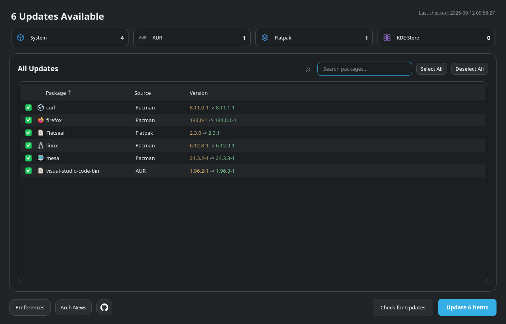
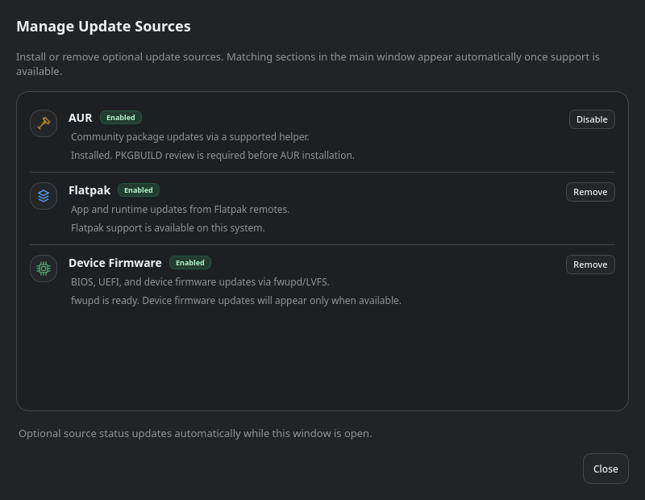
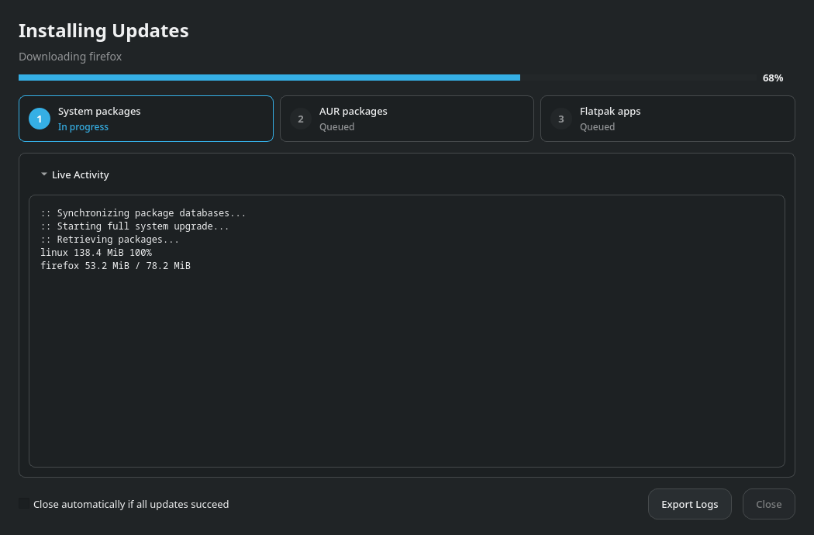
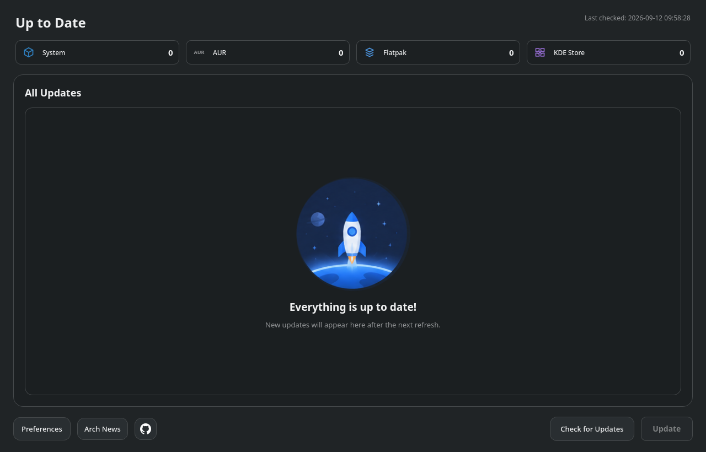

# ArchUpdater

**A simple, direct way to keep your Arch desktop up to date.**

[](https://github.com/Darayavaush-84/ArchUpdater/releases/latest)
[](https://github.com/Darayavaush-84/ArchUpdater/actions/workflows/ci.yml)
[](LICENSE)

ArchUpdater brings system packages, AUR, Flatpak, firmware and Plasma add-ons into one desktop
application. Open it, see what needs attention, review the changes and update, while details and
logs stay within reach.



## Features

ArchUpdater focuses on updating the software already on your system, on the short path from
**“Are there updates?”** to **“What changed?”**, not on browsing a software catalog.

- **Simple to read**: one searchable package list with counters per source.
- **Direct to use**: check, review and update from the same window.
- **Details when you need them**: package information, Arch Linux news, prompts and live logs.
- **A clear finish**: results stay visible after an update, and the latest one can be reopened later.
- **Quiet in the background**: tray icon with update count and status, configurable automatic
  checks and notifications.

| Source | What ArchUpdater does |
| --- | --- |
| **System packages** | Checks and updates with Pacman, always as a full system transaction. |
| **AUR** | Uses a detected helper (`paru`, `yay` or `pikaur`) to find updates. Off by default; build files must be reviewed before building. |
| **Flatpak** | Handles user and system installations and verifies the installed versions. |
| **Firmware** | Shows and installs firmware updates through `fwupd`. |
| **Plasma add-ons** | Checks supported KDE Store add-ons, with Plasma restart guidance where needed. |

Optional sources appear when their support is installed and active. Manage them from
**Preferences → Manage Update Sources**, which can also install or remove the supported
packages; AUR helpers must be installed manually.



## Install

**Requirements**
- Arch Linux or an Arch-based distribution running **systemd** (see [Security](#security) for why)
- Python **3.12+**
- KDE Plasma, only for Plasma-specific features

[Download the project ZIP](https://github.com/Darayavaush-84/ArchUpdater/archive/refs/heads/main.zip),
extract it and run the installer in the extracted folder, or clone the project:

```bash
git clone https://github.com/Darayavaush-84/ArchUpdater.git
cd ArchUpdater
sudo ./install.sh
```

The installer first checks that systemd is running, and stops without changes if it is not.
It then installs any missing system dependencies (`git`, `python`, `pacman-contrib`, `fakeroot`,
`polkit`, `qt6-svg`, `github-cli`) through a `pacman -Syu --needed` transaction you review,
and the Python dependencies automatically. ArchUpdater goes into a versioned environment under
`/opt/archupdater`, together with the launcher, the privileged helper and its Polkit policy.
Run `sudo ./install.sh` again to install a newer checked-out version.

Launch **ArchUpdater** from the application menu or with `archupdater`. It runs as your normal
user and asks for authorization only for privileged operations.

## Everyday use

1. **Check.** Opening ArchUpdater starts a scan (reopening it from the tray does not); periodic
   checks follow your chosen interval, also across restarts. Manual checks are always available.
2. **Review.** Filter by source, compare versions, open package details or Arch News.
3. **Choose** the optional updates to install; system packages are always updated as a whole.
4. **Update** and follow progress, answering any prompts in the app.
5. **See the result**: what completed, what needs attention and whether a restart is advised.
   **Last Update** reopens the latest result with its exportable log, even after a reboot.





*Screenshots show the 1.0.0 interface with demonstration data; the look also depends on your
Qt theme and display scaling.*

## Updating ArchUpdater

When a newer stable release exists, a green **Update** label appears beside the GitHub icon.
Releases are checked at startup and on manual checks, never periodically. Click it, read the
release notes and choose **Update and Restart**.

The update installs **only ArchUpdater**, offline, with the dependencies already on your
computer; it never runs Pacman. The download is verified against a GitHub artifact attestation
tied to this repository, its release workflow and the version tag, and verified again by the
privileged installer. The new version is checked before it becomes active, and the previous one
is kept. No GitHub account or token is needed. Releases without an attestation, or needing newer
dependencies, are installed with their `install.sh` instead. Updating is unavailable while
another ArchUpdater operation is running.

If ArchUpdater does not start after an update, restore the previous version:

```bash
pkexec /usr/lib/archupdater/archupdater-self-update --archupdater-auth=self-update --rollback
```

## Security

ArchUpdater keeps Arch's maintenance rules visible instead of hiding them:

- Pacman updates remain full system transactions; conflicts and replacements that need a
  decision are asked in the app.
- Update plans that change after your review, for Pacman and system Flatpaks, need confirmation again.
- If Arch Linux news cannot be checked, proceeding requires an explicit override.
- Privileged steps run in a separate helper that asks for administrator authentication
  through Polkit each time it starts, once per update session.
- ArchUpdater's own updates must carry a valid release attestation.

**AUR builds** need extra care because they run community-maintained scripts:

- The build files must be reviewed before building, and only the reviewed files are built.
- Each package is built in an **isolated, temporary systemd service** (`systemd-run` with
  `DynamicUser=`), which is why systemd is required: the build runs under a short-lived system
  account, cannot read your home directory, and other programs running as you cannot alter the
  reviewed files or replace the package before it is installed.
- For development (`-git`) packages, the approved Git commit is verified before any upstream
  code runs, and exactly that commit is built.
- From your `makepkg.conf`, only `MAKEFLAGS` job limits (`-j`, `-l`) and `PACKAGER` are used.

Distributions with another init system, such as Artix, are not supported: installing the
`systemd` package would not help, because it must be the running init.

## Uninstall

```bash
sudo archupdater-uninstall                    # keep your settings and logs
sudo archupdater-uninstall --purge-user-data  # also remove them
```

`--purge-user-data` removes only ArchUpdater's settings, logs, caches, AUR state and autostart
entry, with your own permissions. With custom XDG directories, preserve them through sudo:
`sudo --preserve-env=XDG_CONFIG_HOME,XDG_CACHE_HOME,XDG_STATE_HOME archupdater-uninstall --purge-user-data`.

## Development

```bash
python3 -m venv .venv
source .venv/bin/activate
python -m pip install -c constraints-ci.txt -e '.[dev]'
python -m archupdater
```

Checks run by CI:

```bash
ruff check src tests scripts
python -m vulture src tests --min-confidence 80
QT_QPA_PLATFORM=offscreen python -m unittest discover -s tests
scripts/check_translations.sh
scripts/build_distribution.sh
```

Running from source does not install the privileged helper; use `install.sh` to test privileged
flows. In containers without systemd, `ARCHUPDATER_SKIP_SYSTEMD_CHECK=1` lets the installer run,
but AUR updates do not work there. See the [architecture guide](docs/architecture.md) for module
boundaries and [releasing](docs/releasing.md) for publishing a new version.

## Feedback and contributions

[Report an issue](https://github.com/Darayavaush-84/ArchUpdater/issues) with the steps to
reproduce it, the update source involved and relevant logs, with personal information removed.
Contributions that make routine updates clearer and easier to follow are welcome.
Release history is in the [changelog](CHANGELOG.md).

## License

ArchUpdater is licensed under **GPL-3.0-or-later**; see [LICENSE](LICENSE). The GitHub logo is a
trademark of GitHub, Inc.; its asset notice is included in the project.
